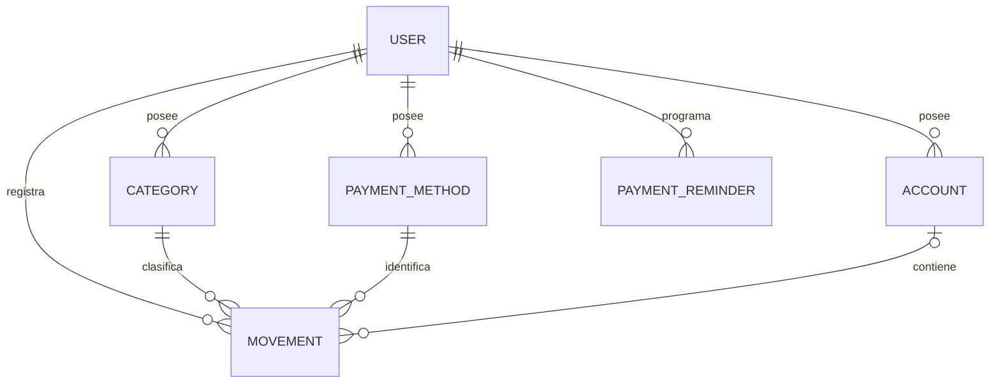

# Modelo definitivo de Controla+

El modelo físico usa seis tablas de aplicación en el esquema `public`, dos enums y una vista académica opcional que instala `roles.sql`. Prisma mantiene además la tabla técnica `_prisma_migrations`.

## Diccionario de datos

| Tabla | Columnas y tipos | Claves y restricciones |
|---|---|---|
| `User` | `id uuid`, `name text`, `email text`, `passwordHash text`, `createdAt timestamp(3)` | PK `id`, unicidad de `email`. Express normaliza el correo y almacena bcrypt. |
| `Category` | `id uuid`, `name text`, `type MovementType`, `userId uuid` | PK `id`, FK a `User`, unicidad `(name,userId)` y `(id,userId,type)`. |
| `PaymentMethod` | `id uuid`, `name text`, `userId uuid` | PK `id`, FK a `User`, unicidad `(name,userId)` y `(id,userId)`. |
| `Account` | `id uuid`, `name text`, `initialBalance numeric(10,2)`, `isActive boolean`, `createdAt timestamp(3)`, `userId uuid` | PK `id`, FK a `User`, unicidad `(name,userId)` y `(id,userId)`. El saldo inicial es finito y mayor o igual a cero. |
| `Movement` | `id uuid`, `type MovementType`, `amount numeric(10,2)`, `description text?`, `date timestamp(3)`, `userId uuid`, `categoryId uuid`, `paymentMethodId uuid`, `accountId uuid?` | PK `id`, FK a `User`, tres FK compuestas. Monto positivo y finito. |
| `PaymentReminder` | `id uuid`, `type ReminderType`, `name text`, `dueDay integer`, `nextDueDate date`, `amount numeric(10,2)?`, `isActive boolean`, `lastPaidAt timestamp(3)?`, `createdAt timestamp(3)`, `userId uuid` | PK `id`, FK a `User`. Día entre 1 y 31. Si se informa el monto, debe ser positivo y finito. |

`?` indica una columna nullable. Prisma genera los UUID cuando crea registros. El DML directo debe proporcionar los UUID. Las marcas `createdAt` y `Movement.date` tienen valores predeterminados de tiempo en PostgreSQL. Las cuentas y los recordatorios tienen `isActive = true` por defecto. `MovementType` contiene `INCOME` y `EXPENSE`. `ReminderType` contiene `CREDIT_CARD` y `CREDIT`.

## Pertenencia y acciones referenciales

- `Movement(categoryId,userId,type)` referencia `Category(id,userId,type)`.
- `Movement(paymentMethodId,userId)` referencia `PaymentMethod(id,userId)`.
- `Movement(accountId,userId)` referencia `Account(id,userId)`. `MATCH SIMPLE` conserva el caso histórico con `accountId = NULL`. La API exige una cuenta propia y activa para altas y ediciones.
- Las tres referencias compuestas usan `NO ACTION` sobre borrado y actualización. Una cuenta referenciada no se puede eliminar sin resolver su relación. Las relaciones directas de propiedad con `User` tienen borrado en cascada. El rol de aplicación carece de permiso para borrar usuarios.

Los índices no únicos son `Movement(userId,date)`, `Movement(accountId,date)`, `PaymentReminder(userId,isActive)` y `PaymentReminder(userId,nextDueDate)`. El saldo corriente se calcula a partir del saldo inicial, ingresos y gastos vinculados a la cuenta.

El [modelo Prisma](../backend/prisma/schema.prisma) define el mapeo de la aplicación. Las [migraciones SQL](../backend/prisma/migrations/) contienen el DDL, incluidos los `CHECK`. Consulta el [DDL académico](ddl-demo.sql), el [DML académico](dml-demo.sql) y los [roles](../docs/roles-y-permisos.md).
