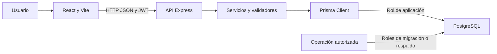

# Arquitectura de Controla+

Controla+ usa un monolito modular en Express, un frontend React compilado con Vite y un único PostgreSQL. Prisma implementa el acceso a datos y aplica migraciones SQL versionadas.

El frontend contiene la sesión por pestaña, los formularios, el panel, los filtros, los reportes y la exportación. La captura por voz depende de la API de reconocimiento del navegador y prepara un borrador que la persona revisa antes de guardarlo.

Express separa rutas, controladores, validadores y servicios. El middleware verifica un JWT y establece el usuario de cada solicitud. La API filtra por propietario. PostgreSQL garantiza integridad con claves compuestas, enums, unicidad y restricciones. Los roles de administración, migración, aplicación, respaldo y consulta académica se aprovisionan en la base dedicada.

La configuración se inyecta por proceso. La suite reproduce la API real, el frontend compilado y PostgreSQL en loopback con bases temporales y credenciales aleatorias. Consulta las guías de [seguridad](seguridad.md), [roles](roles-y-permisos.md) y [recuperación](mantenimiento-y-recuperacion.md).

El panel procesa el conjunto del usuario en React. Los filtros y agregados para los gráficos se recalculan cuando cambian sus entradas. La lista presenta las 1000 filas del escenario de aceptación y comparte instancias de formateo de fecha y moneda. El estado de datos permanece dentro del panel de la sesión activa. [Evidencias del perfilado y la aceptación](evidencias/05-rendimiento-final.md)
